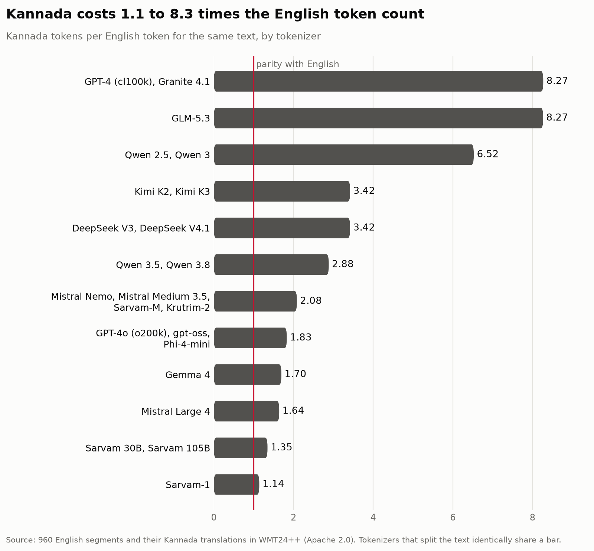

# kannada-llm-bench

How many tokens Kannada costs in language model tokenizers, measured so anyone can rerun it.

## Token tax

The same text costs between 1.1 and 8.3 times as many tokens in Kannada as in English, depending on the tokenizer. More tokens means a higher bill, slower answers and less room in the context window for the same message.



The test text is the 960 English segments of [WMT24++](https://huggingface.co/datasets/google/wmt24pp) with their professional Kannada translations (Apache 2.0). A segment is a sentence or a short paragraph from news, social media posts, speech transcripts or literature, drawn from 170 documents. Each tokenizer counts both sides without special tokens.

2 measures, for 2 questions:

- **Kannada tokens per English token** is the token tax: how much more a Kannada user pays than an English user of the same model for the same text. It is the Kannada total over the English total, so it also depends on how well the tokenizer handles English.
- **Kannada tokens per Kannada word** compares tokenizers on Kannada alone, since every tokenizer divides by the same 23,778 words.

| Tokenizer | Used by | Kannada tokens per English token | 95% interval | Kannada tokens per Kannada word |
|---|---|---|---|---|
| cl100k | GPT-4, GPT-3.5, Granite 4.1 | 8.27 | 8.06 to 8.48 | 14.3 |
| GLM-5.3 | GLM-5.3 | 8.27 | 8.06 to 8.48 | 14.3 |
| Qwen 2.5 | Qwen 2.5, Qwen 3 | 6.52 | 6.37 to 6.68 | 11.4 |
| Kimi | Kimi K2, Kimi K3 | 3.42 | 3.35 to 3.50 | 5.9 |
| DeepSeek | DeepSeek V3, DeepSeek V4.1 Flash | 3.42 | 3.34 to 3.50 | 6.0 |
| Qwen 3.5 | Qwen 3.5, Qwen 3.8 | 2.88 | 2.82 to 2.95 | 5.0 |
| Tekken | Mistral Nemo, Mistral Medium 3.5, Sarvam-M, Krutrim-2 | 2.08 | 2.04 to 2.13 | 3.7 |
| o200k | GPT-4o, GPT-4.1, o-series, gpt-oss 20B and 120B, Phi-4-mini | 1.83 | 1.80 to 1.87 | 3.1 |
| Gemma 4 | Gemma 4 | 1.70 | 1.65 to 1.74 | 3.0 |
| Mistral Large 4 | Mistral Large 4 | 1.64 | 1.61 to 1.67 | 2.9 |
| Sarvam | Sarvam 30B, Sarvam 105B | 1.35 | 1.32 to 1.38 | 2.4 |
| Sarvam-1 | Sarvam-1 | 1.14 | 1.12 to 1.17 | 2.3 |

The interval comes from resampling whole documents, because segments from 1 document share names and style.

What the numbers say:

- 23 tokenizers reduce to 12 distinct ones on this text. Tokenizers in 1 row split every segment into the same tokens, because the models share a vocabulary: Sarvam-M and Krutrim-2 use Mistral's Tekken, and Granite 4.1 uses cl100k. [identical.txt](results/token-tax/identical.txt) lists the groups.
- Qwen cut its Kannada cost by more than half between Qwen 3 and Qwen 3.5. Mistral Large 4 is the only Mistral tokenizer measured below 2.
- Sarvam's own tokenizers come closest to parity. Sarvam-1's low ratio is partly English cost: it spends 48,257 tokens on the English side, against 40,372 to 42,398 for the others. On Kannada alone, Sarvam-1 (2.3 tokens per word) and Sarvam 30B and 105B (2.4) are close.
- Kannada joins suffixes onto words, so it has fewer words than the English (23,778 against 32,262). Tokens per word is therefore not comparable across the 2 languages; use it only to compare tokenizers on Kannada.
- News costs the most in every tokenizer. Speech costs the least in all but Kimi, where literature does. [summary.csv](results/token-tax/summary.csv) has the ratio for each domain, and [counts.csv](results/token-tax/counts.csv) has the counts for every segment.

Not measured:

| Tokenizer | Why |
|---|---|
| Llama 3.1, Llama 4 | Hugging Face gates the files behind Meta's license terms |
| Gemma 3 | Gated behind Google's Gemma terms. Gemma 4 is open |
| Tiny Aya | Gated behind Cohere's terms |
| Claude | Not public. Anthropic's token-counting API can count it with an API key |
| Gemini | Not public. Google's countTokens API can count it with an API key |

### Rerun it

```sh
uv sync --extra chart
uv run kbench token-tax         # downloads the pinned data and tokenizer files, writes results/token-tax
uv run kbench token-tax --only gemma4   # recount 1 tokenizer and keep the other counts
uv run kbench token-tax-chart   # draws the chart in light and dark, as SVG and PNG
```

Every source is pinned: the WMT24++ file by revision and SHA-256, each Hugging Face tokenizer by commit, and the OpenAI encodings by tiktoken's own checksums. Add a tokenizer in [registry.py](src/kbench/tokentax/registry.py).

## Development

```sh
uv run pytest            # offline tests, under 5 seconds
uv run pytest -m network # the test that downloads a tokenizer
uv run ruff check . && uv run ruff format --check .
```

## License

Code: MIT. Results in `results/`: CC BY 4.0. The WMT24++ text is Apache 2.0 and is downloaded, not stored here. See [DATA-LICENSE.md](DATA-LICENSE.md).
